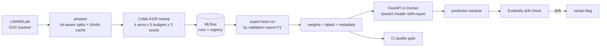

# Wafer defect classification on WM-811K: supervised vs semi-supervised, with an MLOps layer

Semiconductor fabs produce wafer maps by the million, but only a small share ever get a human defect label.
This project asks how much that matters: **how far can self-supervised and semi-supervised learning close the gap when labels are scarce?**
It answers with a controlled comparison across label budgets, then wraps the best model in the pipeline a team would need to ship and watch it: tracked experiments, a model registry, a containerised API, CI with a quality gate, and drift monitoring that raises a retrain flag.

## The data

[WM-811K (LSWMD)](https://www.kaggle.com/datasets/qingyi/wm811k-wafer-map): 811,457 wafer maps (die-level grids with background, good-die and defective-die values) from 46,293 lots.

| | maps |
|---|---|
| labeled | 172,950 (21%) |
| unlabeled | 638,507 (79%) |

Nine labels: `none` 147,431, `Edge-Ring` 9,680, `Edge-Loc` 5,189, `Center` 4,294, `Loc` 3,593, `Scratch` 1,193, `Random` 866, `Donut` 555, `Near-full` 149.
The imbalance (`none` is 85% of labeled maps, `Near-full` is 0.09%) is why every result is reported as **macro-F1 and per-class recall**, never accuracy.

**Leakage control.** Wafers from one lot are correlated, so splits are made by lot (`StratifiedGroupKFold`, class-stratified): no lot appears in more than one of train, val and test (`tests/test_splits.py`). Unlabeled maps from val or test lots are dropped from the pretraining pool, so no arm ever sees a held-out lot, even without labels. With seed 0: 121,061 labeled train maps, 617,529 unlabeled train maps (of 638,507), 17,288 val, 34,601 test.

## Experiment

Four arms, each trained at 1%, 5%, 10%, 25% and 100% of the labeled training maps, with 3 seeds per cell.

| arm | what it does |
|---|---|
| GBM on features | XGBoost on hand-built radial and angular defect-density features: the classical baseline |
| CNN, supervised | ResNet-18 trained from scratch on the labeled maps only |
| SimCLR + fine-tune | ResNet-18 pretrained contrastively on every training map (labeled or not), then fine-tuned on the labeled budget |
| FixMatch | ResNet-18 trained on the labeled budget plus consistency-regularised pseudo-labels from the unlabeled pool (which includes the labeled maps whose labels this run is not allowed to use) |

Controls that keep the comparison fair:

- Same backbone, optimiser, step budget (4,000 steps), batch size and class-weighted loss across the three neural arms. SimCLR's fine-tuning uses exactly the supervised CNN's loop, so the only difference is initialisation.
- Label budgets are nested per seed (the 5% subset contains the 1% subset) and always keep at least one sample of every class.
- Checkpoints are chosen on the validation split, and the test split is touched once per run.
- Results are mean +/- 1 std over seeds, as a label-efficiency curve.

### Results

Run the sweep (below), then `python -m wm811k.cli results` writes `artifacts/results.csv`, `artifacts/runs.csv` (per-run, including per-class recall) and `artifacts/label_efficiency.png`.
Copy the chart to `docs/` and the key numbers into this section once you have them. The numbers are generated, never hand-typed.

Caveats to state alongside the results:

- The full validation split (17,288 maps) is used for checkpoint selection at every label budget, so the low-budget runs have more validation labels than training labels. This flatters low-budget numbers a little, for every arm equally.
- SimCLR is pretrained once and shared by every fine-tune seed, so its error bars do not include pretraining variance.
- Maps are resized to 64x64 with nearest-neighbour sampling, which can erase thin defects (e.g. `Scratch`) on the largest maps.

## MLOps layer



- **Experiment tracking and registry:** every run logs its config, tags (`arm`, `model`, `fraction`, `seed`) and metrics to MLflow (SQLite store). Full-label neural runs also log the trained model; `export` picks the best by validation macro-F1, registers it as `wafer-classifier`, and writes `weights.pt`, `labels.json` and `metadata.json` to `models/best_model/`.
- **Serving:** a FastAPI app in a multi-stage Docker image (CPU torch, main dependencies only). `POST /predict` takes a wafer map of any size up to 512x512 with values in {0, 1, 2}; invalid input gets a 422, never a 500.
- **CI (GitHub Actions):** ruff, the test suite, and a **quality gate** that fails the build if the committed model's test macro-F1 drops below `gate.min_macro_f1`. A second job builds the image and smoke-tests `/health` and `/predict`. The gate and the image job switch on once a model is committed.
- **Drift monitoring:** the service keeps a window of recent predictions (die count, defect ratio and predicted label of each resized map). `GET /drift-report` compares it with a reference built from validation maps using Evidently and returns the HTML report; if the window has drifted it writes `artifacts/retrain.flag`. Fewer than 200 predictions never raises an alarm. `simulate-drift` demonstrates it end to end.

## Running it

```bash
poetry install                      # Python 3.11; torch comes from the CPU wheel index
poetry run pytest                   # the full suite

# 1. build the compressed data cache (needs LSWMD.pkl in the repo root)
poetry run python -m wm811k.cli prepare
# 2. run the sweep on Colab: upload artifacts/experiment_data.npz to Drive and open
#    notebooks/colab_run.ipynb (A100). Or locally, one arm at a time:
poetry run python -m wm811k.cli sweep gbm cnn simclr fixmatch
# 3. results chart and tables
poetry run python -m wm811k.cli results
# 4. register + export the best full-label model, then build the drift reference
poetry run python -m wm811k.cli export
poetry run python -m wm811k.cli reference
# 5. set gate.min_macro_f1 in conf/config.yaml just under the exported model's test macro-F1
poetry run python -m wm811k.cli gate

# serve
docker build -t wm811k . && docker run -p 8080:8080 wm811k
curl -X POST localhost:8080/predict -H "Content-Type: application/json" \
     -d '{"wafer_map": [[0,1,1,0],[1,2,1,1],[1,1,2,1],[0,1,1,0]]}'

# drift demo against the running service
poetry run python -m wm811k.cli simulate-drift
```

Any config value can be overridden on the command line, e.g. `budgets=[0.05,1.0] seeds=[0] train.steps=2000`.

## Layout

```
conf/config.yaml          all settings (Hydra)
src/wm811k/
  data.py preprocess.py splits.py features.py      loading, resizing, lot-aware splits, features
  models.py training.py augment.py metrics.py      backbone, shared training loop, augmentations
  arms/                                            supervised, simclr, fixmatch (+ MLflow run logging)
  sweep.py results.py export.py gate.py            sweep runner, charts, model export, quality gate
  api/ drift.py monitoring.py http_client.py       serving, drift monitoring and its simulation
  cli.py                                           python -m wm811k.cli <command>
notebooks/colab_run.ipynb                          resumable A100 sweep
docs/superpowers/                                  design spec and implementation plan
```
