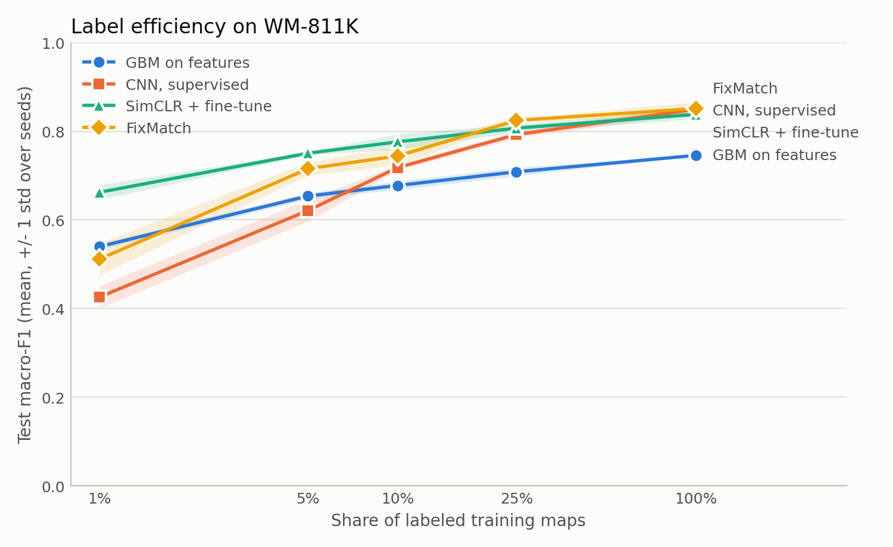
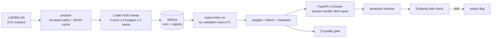

# Wafer defect triage with semi-supervised and self-supervised learning

Semiconductor fabs produce millions of wafer maps, but only a small share ever get a human defect label.
In this project I study how much that matters: **when labels are scarce, how much of the gap to a fully labeled model can self-supervised and semi-supervised learning close?**
I answer it with a controlled comparison across five label budgets on WM-811K. I then wrap the best model in the pipeline a team would need to ship and monitor it: tracked experiments, a model registry, a containerised API, CI with a quality gate, and drift monitoring that raises a retrain flag.

## Background

Both approaches try to get value out of unlabeled data, but in different ways.

**Semi-supervised learning** trains on a small labeled set and a large unlabeled set together.
The classic recipe is self-training:

1. Train a model on the labeled data.
2. Use it to predict labels for the unlabeled data, and keep only the high-confidence predictions (pseudo-labels).
3. Retrain on the labeled and pseudo-labeled data together, and repeat.

Labeling thousands of examples by hand is slow and expensive, so this often gives better accuracy and generalisation than training on the scarce labels alone.
It has two main risks:

- **Confirmation bias.** A wrong pseudo-label is trained on as if it were true, so the model can lock in its own mistakes and amplify them over training.
- **Broken assumptions.** The method assumes that points close together in the data share a class. When the data's structure is complex or breaks that assumption, the unlabeled data can add little or even hurt.

**Self-supervised learning** uses no labels at all in its first stage.
The model solves a pretext task whose answer comes from the data itself.
BERT, for example, learns by predicting words that have been masked out of a sentence.
Solving the pretext task forces the network (the encoder) to learn general-purpose features.
The pretrained encoder is then fine-tuned on a small labeled set for the real task. This is called downstream fine-tuning.
The same two-stage pattern underlies the pretraining of today's large language models.

**How this project uses them:**

- **FixMatch** (semi-supervised) does pseudo-labeling online, within each training step, rather than in separate retraining rounds. The model labels a lightly augmented copy of each unlabeled map (a flip), keeps only predictions with at least 95% confidence, and is trained to give the same label to a heavily augmented copy (rotation, flip and die dropout). The high threshold limits confirmation bias.
- **SimCLR** (self-supervised) uses a contrastive pretext task instead of masked prediction. Two random augmentations of the same wafer map must produce matching embeddings, and maps that differ must produce different ones. It pretrains on all 738,590 training maps, labeled or not, and the encoder is then fine-tuned on each label budget.

## Results

60 runs: 4 methods × 5 label budgets × 3 seeds, all scored on the same lot-disjoint test set of 34,601 wafers.



**Test macro-F1, mean ± std over 3 seeds**

| Labels used | GBM on features | CNN, supervised | SimCLR + fine-tune | FixMatch |
|---|---|---|---|---|
| 1% (1,210 maps) | 0.540 ± 0.007 | 0.426 ± 0.025 | **0.662** ± 0.017 | 0.512 ± 0.036 |
| 5% | 0.654 ± 0.007 | 0.621 ± 0.025 | **0.751** ± 0.004 | 0.716 ± 0.015 |
| 10% | 0.678 ± 0.009 | 0.718 ± 0.006 | **0.776** ± 0.017 | 0.744 ± 0.021 |
| 25% | 0.709 ± 0.010 | 0.793 ± 0.008 | 0.807 ± 0.009 | **0.825** ± 0.005 |
| 100% (121,061 maps) | 0.746 ± 0.000 | 0.850 ± 0.010 | 0.838 ± 0.010 | **0.851** ± 0.014 |

The numbers come from `artifacts/results.csv`, which `python -m wm811k.cli results` writes from the MLflow store.

**Findings**

- **Below 10% labels, SimCLR pretraining gives the biggest gain.** At 1% it beats the supervised CNN by 23.6 macro-F1 points, and it wins in every seed. That score matches a CNN trained on about 6.7% of the labels, roughly 6.7× the labels.
- **FixMatch leads at 25%** (0.825), close to the CNN trained on every label (0.850). That's roughly what a CNN gets from about 54% of the labels.
- **With all the labels, the semi-supervised methods add nothing.** FixMatch and the CNN differ by 0.001, well inside seed noise.
- **GBM beats the CNN at 1–5% labels, then stops improving at about 0.75.** It never finds more than 8% of scratches, because its radial and angular density features can't represent a thin line of dies.
- **Scratch is the hardest class for every method at every budget.** It has the lowest recall throughout. Below full labels the CNN finds at most 24% of scratches, while FixMatch finds 58% at 25% labels. SimCLR's early lead comes mostly from Loc and Edge-Loc: at 1% labels the CNN finds 1–3% of them and SimCLR finds 42–52%.

Within each seed, all methods train on the same labeled subset, so they can be compared seed by seed. The leads at 1–25% hold in all 3 seeds.

**The deployed model** is the full-label FixMatch run with the best validation macro-F1 (seed 1). Its scores:

- **Test macro-F1:** 0.843.
- **As a defect screen:** it flags 94.3% of defective wafers, falsely flags 1.6% of clean wafers, and 91.0% of the wafers it flags are really defective.
- **Weakest class:** Edge-Loc, with precision 0.69. Most of its false positives are clean wafers.
- **Confidence:** well calibrated (expected calibration error 0.008). Sending every wafer below 0.9 confidence to an engineer means reviewing 6.6% of wafers and cuts automatic errors by three quarters.

The full analysis is in [`docs/results/wm811k-results.html`](docs/results/wm811k-results.html): seed-by-seed gains, per-class recall at each budget, the confusion matrix, and review-threshold trade-offs. Download it and open it in a browser.

**Caveats**

- Three seeds per point, so differences under about 2 points (SimCLR vs. FixMatch at 25%, anything at 100%) agree in direction across seeds but aren't established.
- The full validation split (17,288 maps) is used for checkpoint selection at every budget, so low-budget runs have more validation labels than training labels. This inflates low-budget scores a little, equally for every method. For the neural methods, validation macro-F1 is up to 3 points above test.
- Among the nine full-label neural runs, validation order barely predicts test order: they sit within 2.5 points of each other. The exported model is a reasonable choice, but not clearly the best one.
- SimCLR is pretrained once and shared by every fine-tune seed, so its error bars don't include variation from pretraining.
- Near-full has only 30 test maps, so one map moves its recall by 3.3 points.
- Maps are resized to 64×64 with nearest-neighbour sampling, which can erase thin defects like Scratch on the largest maps. That may account for part of the Scratch gap.
- The sweep logs per-class recall but not precision. Precision figures above are for the exported model only.

## The data

[WM-811K (LSWMD)](https://www.kaggle.com/datasets/qingyi/wm811k-wafer-map) has 811,457 wafer maps from 46,293 lots. Each map is a die-level grid where every cell is background, a good die, or a defective die.

| | maps |
|---|---|
| labeled | 172,950 (21%) |
| unlabeled | 638,507 (79%) |

Nine labels: `none` 147,431, `Edge-Ring` 9,680, `Edge-Loc` 5,189, `Center` 4,294, `Loc` 3,593, `Scratch` 1,193, `Random` 866, `Donut` 555, `Near-full` 149.
The classes are heavily imbalanced: `none` is 85% of labeled maps and `Near-full` is 0.09%. That's why every result is reported as **macro-F1 and per-class recall**, never accuracy.

**Leakage control.** Wafers from the same lot are correlated, so splits are made by lot (`StratifiedGroupKFold`, class-stratified). No lot appears in more than one of train, val and test (`tests/test_splits.py`). Unlabeled maps from val or test lots are dropped from the pretraining pool, so no method ever sees a held-out lot, even without labels. With seed 0 the splits are:

- 121,061 labeled training maps
- 617,529 unlabeled training maps (of 638,507)
- 17,288 validation maps
- 34,601 test maps

## Experiment

Four methods ("arms" in the code), each trained at 1%, 5%, 10%, 25% and 100% of the labeled training maps, with 3 seeds per budget.

| arm | what it does |
|---|---|
| GBM on features | XGBoost on hand-built radial and angular defect-density features: the classical baseline |
| CNN, supervised | ResNet-18 trained from scratch on the labeled maps only |
| SimCLR + fine-tune | ResNet-18 pretrained contrastively on every training map (labeled or not), then fine-tuned on the labeled budget |
| FixMatch | ResNet-18 trained on the labeled budget plus confident pseudo-labels on the unlabeled pool. The pool includes the labeled maps whose labels this run is not allowed to use. |

Controls that keep the comparison fair:

- The three neural methods share the same backbone, optimiser, step budget (4,000 steps), batch size and class-weighted loss. SimCLR's fine-tuning uses exactly the supervised CNN's training loop, so initialisation is the only difference.
- Label budgets are nested per seed (the 5% subset contains the 1% subset) and always keep at least one sample of every class. A given seed gives every method the same subset.
- Checkpoints are chosen on the validation split, and each run touches the test split once.

On a Colab A100 the full sweep took about 4.6 hours:

| step | time |
|---|---|
| FixMatch | 9.7 min per run |
| SimCLR pretraining | 36 min, once |
| CNN and SimCLR fine-tuning | 2.8 min per run each |
| GBM | under 1 min per run |

## MLOps layer



- **Experiment tracking and registry:** every run logs its config, tags (`arm`, `model`, `fraction`, `seed`) and metrics to MLflow, using a SQLite store. Full-label neural runs also log the trained model. `export` picks the best of those by validation macro-F1, registers it as `wafer-classifier`, and writes `weights.pt`, `labels.json` and `metadata.json` to `models/best_model/`.
- **Serving:** a FastAPI app in a multi-stage Docker image, with CPU-only torch and the main dependencies only. `POST /predict` takes a wafer map of any size up to 512×512 with values in {0, 1, 2}. Invalid input gets a 422, never a 500.
- **CI (GitHub Actions):**
  - Runs ruff and the test suite.
  - Runs a **quality gate**: it re-scores the committed weights on a held-out sample committed alongside them (830 test maps, up to 100 per class), and fails the build if macro-F1 is below `gate.min_macro_f1`. Swapped, corrupted or regressed weights fail it.
  - A second job builds the Docker image and smoke-tests `/health` and `/predict`.
- **Drift monitoring:** the service keeps a window of recent predictions, recording each resized map's die count, defect ratio and predicted label. `GET /drift-report` uses Evidently to compare that window with a reference built from validation maps, and returns the HTML report. If the window has drifted, it writes `artifacts/retrain.flag`. A window with fewer than 200 predictions never raises an alarm. `simulate-drift` demonstrates the whole loop end to end.

## Running it

```bash
poetry install                      # Python 3.11; torch comes from the CPU wheel index
poetry run pytest                   # the full suite

# 1. build the compressed data cache (needs LSWMD.pkl in the repo root)
poetry run python -m wm811k.cli prepare

# 2. run the sweep on Colab: upload artifacts/experiment_data.npz to Drive and open
#    notebooks/colab_run.ipynb with an A100 runtime. It saves to Drive after every run and
#    resumes where it stopped, then writes the results and exports the best model.
#    Download models/best_model/ and artifacts/ from Drive into the repo root afterwards.
#    To sweep locally instead:
poetry run python -m wm811k.cli sweep gbm cnn simclr fixmatch

# 3. results chart and tables (the notebook already wrote them to artifacts/)
poetry run python -m wm811k.cli results

# 4. after a local sweep only (the notebook already ran these):
#    export registers the best full-label model and prints the sample macro-F1 to gate on
poetry run python -m wm811k.cli export
poetry run python -m wm811k.cli reference

# 5. set gate.min_macro_f1 in conf/config.yaml a little under that sample macro-F1, then
poetry run python -m wm811k.cli gate

# serve
docker build -t wm811k . && docker run -p 8080:8080 wm811k
curl -X POST localhost:8080/predict -H "Content-Type: application/json" \
     -d '{"wafer_map": [[0,1,1,0],[1,2,1,1],[1,1,2,1],[0,1,1,0]]}'

# drift demo against the running service
poetry run python -m wm811k.cli simulate-drift
```

Any config value can be overridden on the command line, e.g. `budgets=[0.05,1.0] seeds=[0] train.steps=2000`.
Each run is tagged with a fingerprint of the settings that shaped it: the split, the map size, and the method's own config sections. A quick trial with different settings is therefore never skipped over, mixed into the results, or exported by mistake.

## Layout

```
conf/config.yaml          all settings (Hydra)
src/wm811k/
  data.py preprocess.py splits.py features.py      loading, resizing, lot-aware splits, features
  models.py training.py augment.py metrics.py      backbone, shared training loop, augmentations
  arms/                                            supervised, simclr, fixmatch (+ MLflow run logging)
  sweep.py results.py export.py gate.py            sweep runner, charts, model export, quality gate
  api/ drift.py monitoring.py http_client.py       serving, drift monitoring and its simulation
  cli.py                                           python -m wm811k.cli <command>
models/best_model/                                 exported weights, labels, metadata, gate sample
notebooks/colab_run.ipynb                          resumable A100 sweep
docs/results/                                      label-efficiency chart and full results report
docs/superpowers/                                  design spec and implementation plan
```
